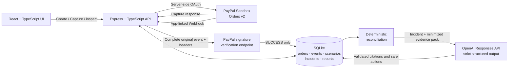

# PayTrace AI

> From a completed PayPal Sandbox capture and a pending merchant order to a reproducible, evidence-backed engineering investigation.

[](https://nodejs.org/)
[](https://developer.paypal.com/home/)
[](./LICENSE)

PayTrace is a developer-first payment incident investigation lab. It correlates a genuine PayPal Sandbox Capture with merchant-owned order state, safely reproduces one merchant-side update failure, detects the mismatch with a deterministic rule, and generates a read-only AI investigation whose claims cite stored evidence.

The project is a local Sandbox prototype, not a production payment system or a general reconciliation platform. Rules determine whether an Incident exists; AI explains the evidence and never receives payment mutation tools.

## What it demonstrates

1. Create, approve, and Capture a real PayPal Sandbox order.
2. Persist separate PayPal and merchant-local states in SQLite.
3. Verify PayPal Webhooks through the official postback endpoint before accepting them as evidence.
4. Intentionally keep the merchant order at `PENDING_PAYMENT` after a confirmed Capture.
5. Open `PAYMENT_CAPTURED_MERCHANT_PENDING` only after an application-defined grace period.
6. Generate a structured investigation with cited facts, ranked hypotheses, material unknowns, and safe inspection steps.
7. Replay or reset the merchant-only scenario without another PayPal Create, Capture, refund, or Webhook-redelivery call.

## Real evidence vs. simulated fault

This distinction is central to the project:

| Evidence | Origin | Meaning |
| --- | --- | --- |
| Order and Capture response | **Real — PayPal Sandbox API** | Authenticated provider evidence from Orders v2 |
| Verified Webhook | **Real — app-linked PayPal Sandbox delivery** | Accepted only after PayPal returns `SUCCESS` from signature verification |
| Merchant order state | **Local merchant application** | PayTrace's own database state, independent of PayPal state |
| Update failure, Replay, Reset | **Simulated — merchant-only demo control** | Reproduces the local integration bug; it does not simulate a PayPal outage or create another payment |
| Investigation report | **AI-assisted or rule-based fallback** | Read-only explanation of an already deterministic Incident |

The implemented incident is deliberately narrow: PayPal Capture status is `COMPLETED` while merchant-local status remains `PENDING_PAYMENT`. Merchant success is `PAID`, never `COMPLETED`.

## Architecture



The API is separated into HTTP routes, workflow services, provider adapters, a transactional repository, and shared contracts. The browser receives only safe public configuration; PayPal and OpenAI secrets remain in the API process.

## Run locally

### Requirements

- Node.js 20 or newer
- A PayPal Developer **Sandbox** REST app
- A Sandbox business account and personal buyer account associated with that environment
- Optional: an OpenAI API key for AI-generated reports
- Optional for genuine Webhook validation: a temporary or hosted public HTTPS URL

### 1. Configure the environment

```bash
cp .env.example .env
```

At minimum, set `PAYPAL_CLIENT_ID` and `PAYPAL_CLIENT_SECRET` from the same Sandbox REST app. Never use live PayPal credentials.

| Variable | Required | Purpose |
| --- | --- | --- |
| `PAYPAL_CLIENT_ID` | Yes | Public Sandbox app identifier; the browser receives this value |
| `PAYPAL_CLIENT_SECRET` | Yes | Server-only Sandbox secret |
| `PAYPAL_API_BASE_URL` | Default supplied | Must remain `https://api-m.sandbox.paypal.com` for this project |
| `PAYPAL_WEBHOOK_ID` | For Webhooks | ID of the Webhook registered on the same Sandbox app |
| `DATABASE_PATH` | Default supplied | SQLite database location |
| `DEMO_MODE` | For fault demo | Set to `true` to expose local-only Simulate, Replay, and Reset controls |
| `RECONCILIATION_GRACE_MS` | Default supplied | Application grace period; it is not a PayPal SLA |
| `OPENAI_API_KEY` | Optional | Server-only key; absence produces an honest grounded fallback |
| `OPENAI_MODEL` | Optional | Model override available to the OpenAI project |
| `OPENAI_API_BASE_URL` | Default supplied | OpenAI API base URL |
| `OPENAI_TIMEOUT_MS` | Default supplied | Bounded investigation timeout |

For the complete local demonstration, use:

```dotenv
DEMO_MODE=true
RECONCILIATION_GRACE_MS=60000
OPENAI_API_KEY=
OPENAI_MODEL=gpt-6.1-terra
```

`gpt-6.1-terra` is the live-verified repository default. Reviewers can select another compatible model available to their OpenAI project with `OPENAI_MODEL`.

### 2. Install and start

```bash
npm ci
npm run dev
```

Open <http://localhost:5173>. The API listens on <http://localhost:3001> by default, and Vite proxies `/api` during development.

On first start with an empty database, the API imports an existing allowlisted `data/orders.json` store if present. Local environment files, SQLite files, and the legacy store are ignored by Git.

### 3. Optional genuine Webhook setup

1. Expose port `3001` through a public HTTPS URL.
2. In the PayPal Developer Dashboard, register `<public-url>/api/webhooks/paypal` on the same Sandbox REST app.
3. Subscribe to `PAYMENT.CAPTURE.COMPLETED` and copy the registered Webhook ID into `PAYPAL_WEBHOOK_ID`.
4. Restart the API before creating and capturing the Sandbox order.

PayPal Webhooks Simulator events do not count as app-linked payment evidence and may not support the same postback verification path. PayTrace fails closed when the signature is invalid or the registered Webhook ID is absent.

## Demo walkthrough

1. Enter a valid amount such as `10.00 USD` and choose **Pay with PayPal Sandbox**.
2. Approve with the Sandbox personal buyer. Confirm the normal state is PayPal `COMPLETED`, merchant `PAID`, with a non-empty Capture ID.
3. Choose **Simulate merchant update failure**. Only merchant state changes to `PENDING_PAYMENT`; the original Capture evidence remains unchanged.
4. Wait for the displayed application grace period and run reconciliation.
5. Inspect the deterministic Incident and follow its Capture and simulated-fault evidence links.
6. Generate the investigation. With no key or with invalid provider output, PayTrace persists a cited `FALLBACK` report instead of hiding the Incident.
7. Use **Replay** to create a distinct local scenario, or **Reset** to resolve the Incident and restore merchant state to `PAID`.
8. Confirm the PayPal order ID, Capture ID, external `COMPLETED` status, and count of PayPal API evidence did not change during Replay or Reset.

Refresh recovery stores only the internal merchant order ID in the browser and restores the Order, timeline, active Scenario, Incident, and persisted investigation through read-only APIs.

## Trust, evidence, and safety model

- PayPal Client Secret and OpenAI API key stay in the backend process.
- The repository stores allowlisted fields only—no raw PayPal payloads, buyer data, OAuth tokens, or secrets.
- A Capture request is accepted only for a PayPal order already mapped to the internal merchant order.
- `PayPal-Request-Id` remains stable per merchant order for Create and Capture attempts.
- PayPal external state and merchant-local state are independent fields with timestamped provenance.
- Webhook payloads cannot change payment evidence until official signature verification succeeds.
- Non-null provider event IDs are unique; duplicate verified delivery is a transactional no-op.
- Unknown order mappings are quarantined instead of being treated as payment truth.
- The AI receives a minimized evidence pack without PayPal order/Capture identifiers or buyer data.
- Strict JSON Schema, Zod validation, evidence-ID validation, state-boundary checks, and financial-action checks gate every AI report.
- AI has no PayPal credentials or mutation tools. Invalid, unavailable, or unconfigured AI degrades to a transparent rule-based fallback.

## Verification

Run the same checks used for the current working tree:

```bash
npm test
npm run lint
npm run build
git diff --check
```

Verified on 2026-11-12:

| Area | Coverage | Result |
| --- | --- | --- |
| API and repository | Create/Capture mapping, idempotent Capture, amount rejection, Webhook verification/deduplication/quarantine, state separation, persistence, Replay/Reset, reconciliation, strict AI output, correction attempt, unsafe output and fallback paths | 27 tests passed |
| Web presentation | Provenance labels, workflow stages, disabled-demo messaging, input validation, countdown/next action, safe workspace persistence | 8 tests passed |
| Static and production checks | TypeScript lint, Vite/API production build, whitespace validation | Passed |

Automated tests use mocked providers and temporary databases, never real credentials.

### External verification already completed

- On 2026-11-02, a genuine `10.00 USD` Sandbox buyer flow returned a real non-empty Capture ID and `COMPLETED` status.
- On 2026-11-04, a genuine `PAYMENT.CAPTURE.COMPLETED` event from the same Sandbox app passed PayPal's official postback verification, remained deduplicated after redelivery, and survived restart.
- On 2026-11-05, merchant-only injection, grace-period reconciliation, Incident idempotency, Replay, and Reset were exercised against retained genuine Capture evidence without another PayPal mutation.
- On 2026-11-06, a live `gpt-5-mini` Responses API request produced an `AI_GENERATED` strict-schema report; every citation resolved, SQLite read-back matched, and order state remained unchanged.
- On 2026-11-09, desktop and narrow-width browser acceptance covered refresh recovery, validation, countdown, keyboard focus, evidence navigation, live diagnosis, Replay, and final Reset.
- On 2026-11-12, the default was migrated to `gpt-6.1-terra`. A live Responses API investigation returned `AI_GENERATED`; every citation resolved, SQLite read-back matched, and payment evidence plus merchant state remained unchanged.

## Current verification status

The P0 product workflow is feature-frozen and manually accepted. The final model migration gate is complete: `gpt-6.1-terra` is the configurable default, the live end-to-end investigation passed, and all 35 automated tests, lint, production build, and whitespace validation pass.

The remaining release work is submission-only: record and publish the public demo video, add the video and Devpost links below, complete the final access/link rehearsal, and perform the human-controlled Devpost submission.

## API surface

| Method | Route | Purpose |
| --- | --- | --- |
| `GET` | `/api/health` | Health check |
| `GET` | `/api/config/paypal` | Safe public Sandbox and demo configuration |
| `POST` | `/api/orders` | Create internal and PayPal Sandbox orders |
| `GET` | `/api/orders/:merchantOrderId` | Read allowlisted order state |
| `GET` | `/api/orders/:merchantOrderId/timeline` | Read ordered evidence |
| `POST` | `/api/orders/:merchantOrderId/capture` | Capture an approved mapped order |
| `POST` | `/api/webhooks/paypal` | Verify and ingest a PayPal Webhook |
| `POST` | `/api/demo/scenario-runs` | Inject the merchant-only demo fault |
| `GET` | `/api/demo/scenario-runs/:scenarioRunId` | Read Scenario and Incident state |
| `POST` | `/api/demo/scenario-runs/:scenarioRunId/reconcile` | Evaluate the deterministic rule |
| `POST` | `/api/demo/scenario-runs/:scenarioRunId/replay` | Create a distinct local Replay |
| `POST` | `/api/demo/orders/:merchantOrderId/reset` | Resolve local demo state and restore `PAID` |
| `POST` | `/api/investigations/scenarios/:scenarioRunId` | Generate and persist an investigation |
| `GET` | `/api/investigations/scenarios/:scenarioRunId` | Read the persisted investigation |

## Positioning and limitations

Payment providers and observability platforms already offer Webhook logs, replay, reconciliation, and anomaly monitoring. PayTrace explores a narrower developer workflow: correlate an actual PayPal Sandbox Capture with merchant-owned state, recreate a controlled merchant-side failure, and turn the Incident into a traceable AI-assisted debugging report. Its value is the focused, testable end-to-end workflow—not a claim that payment anomalies or AI reconciliation were invented here.

Current limitations are intentional:

- Sandbox only; no live money, refunds, chargebacks, or payment retries.
- One merchant-owned incident type, not general payment monitoring or settlement reconciliation.
- Local SQLite and a single application instance; no multi-tenant or distributed-processing guarantees.
- No authentication, production deployment, or shared judge credentials.
- No proof of production scale, commercial demand, or exclusive market novelty.
- Additional fault types, generalized dashboards, multi-PSP support, and Incident-to-Test export remain deferred.

## Project links

- Source: [github.com/Paige668/paypal_ai](https://github.com/Paige668/paypal_ai)
- Demo video: pending publication
- Devpost entry: pending human-controlled submission

## License

MIT. See [LICENSE](./LICENSE).
